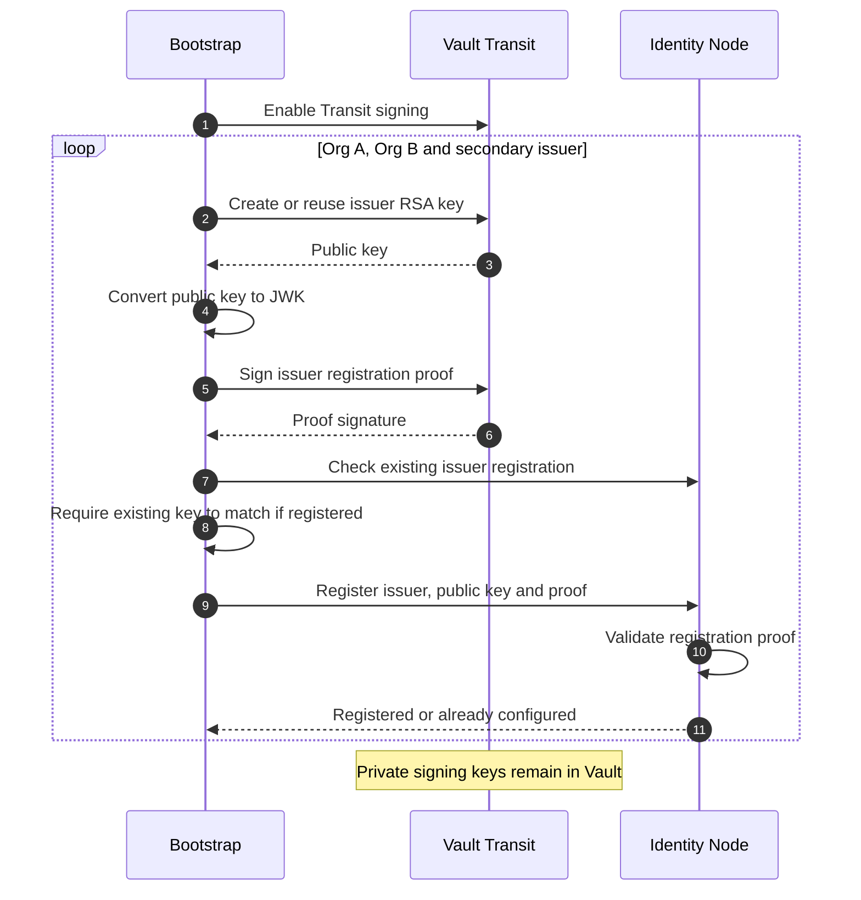
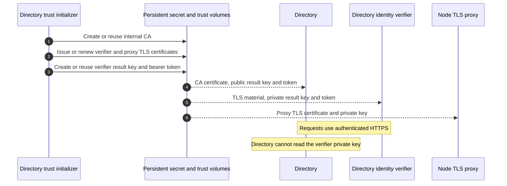
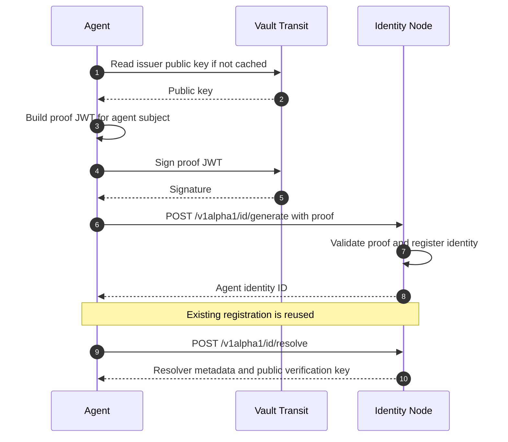
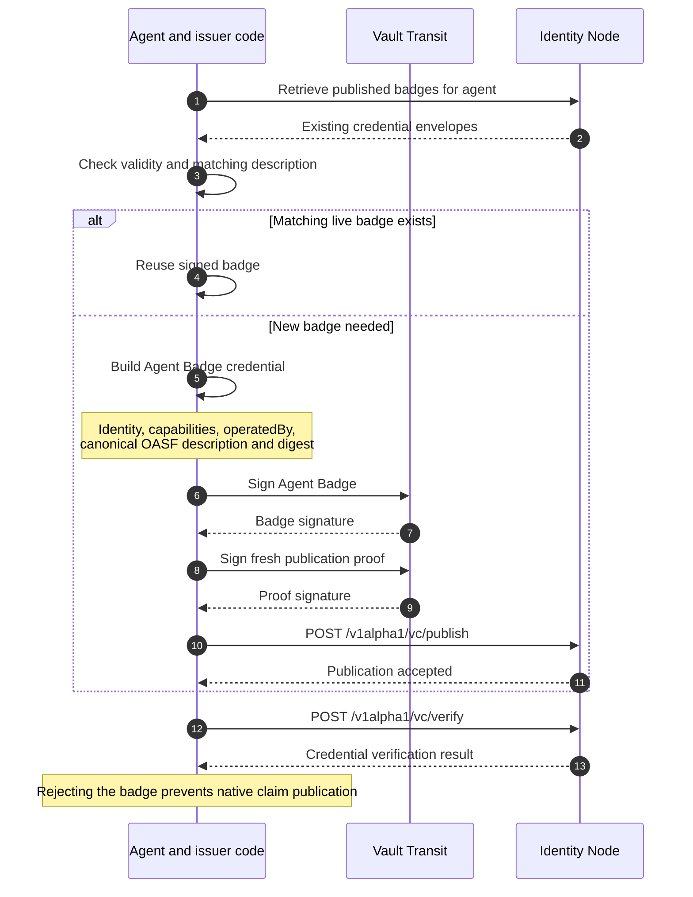
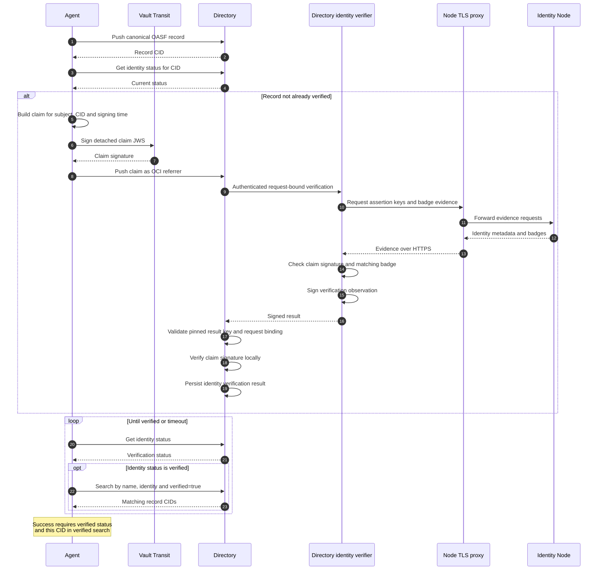
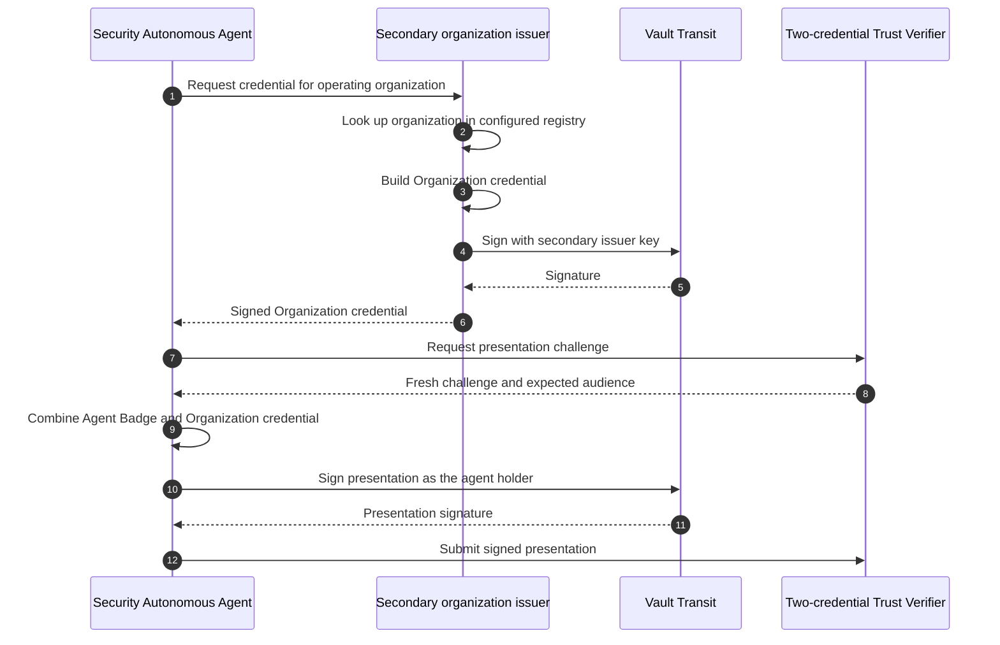
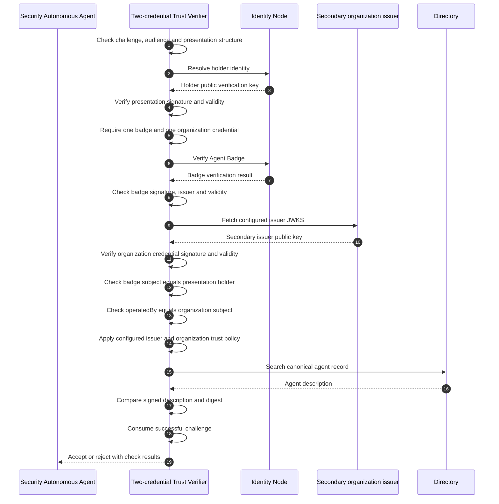
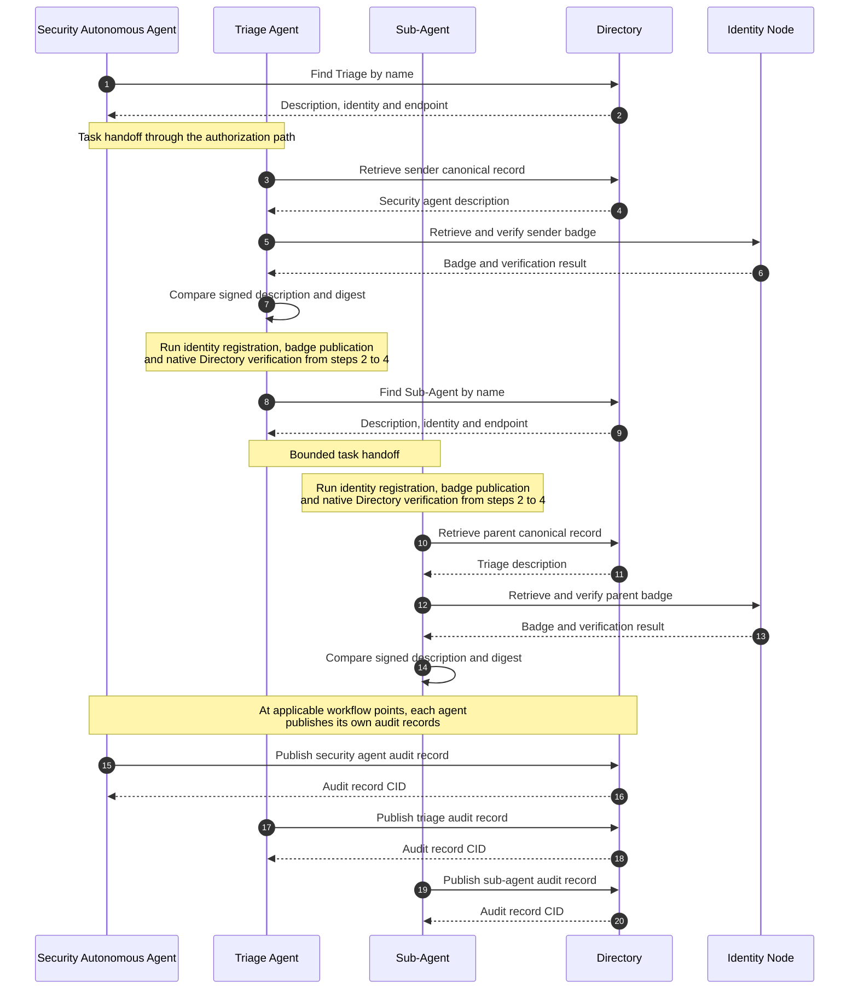

# AGNTCY identity and Directory: the demo sequence

**Status:** Implemented in the demo  
**Date:** November 10, 2026

This walkthrough follows the AGNTCY identity, credential and Directory paths in the demo, including Vault signing and the supporting verification services. Keycloak, Envoy, OPA, OpenCode and Gitea are outside these diagrams. Requests are grouped where necessary for readability; the diagrams explain application behavior rather than individual database queries.

For the proposed organization-attestation extension, see [Supporting D&B attestations](dnb-attestation-proposal.md).

## Components and responsibilities

| Component | Responsibility |
|---|---|
| Bootstrap | Configure organization issuers and signing keys |
| Vault Transit | Hold organization private keys and produce requested signatures |
| Identity Node | Register and resolve identities, publish badges, verify credential evidence |
| Directory | Store descriptions and claim referrers, reconcile identity and serve search |
| Directory identity verifier | Check the native identity claim and matching badge, return a signed observation |
| Node TLS proxy | Provide internal HTTPS access to the existing Node HTTP API |
| Secondary organization issuer | Issue the demo's separate Organization credential with a separate Vault key |
| Two-credential Trust Verifier | Check the presentation, both credentials, organization binding and configured trust policy |

Org A and Org B have separate issuer keys. In this demo, Triage and the Sub-Agent use Org B's configured issuer key; these diagrams do not imply a separate private key for every agent. The deployment shares an Identity Node service.

## 1. Initialize issuer keys and registrations

**What happens:** Startup creates or reuses the configured issuer keys, obtains their public keys and registers the issuers with Identity Node.

**Why:** Node needs the registered public key to validate subsequent registration and credential-publication proofs. Private key material stays in Vault.

### Initialize Directory verification trust

A separate startup task establishes the internal TLS and result-verification material. Its generated verifier private key is distinct from the organization keys in Vault.

## 2. Register and resolve each agent identity

**What happens:** Each agent obtains a Vault-signed proof, registers its identity and resolves the returned ID to public verification metadata.

**Why:** A published name or endpoint alone does not demonstrate key control. Resolution lets another component obtain the verification key associated with the identity.

This path runs for the Security Autonomous Agent, Triage Agent and Sub-Agent. Re-registration is idempotent in the client.

## 3. Create, publish and verify the Agent Badge

**What happens:** The client looks for a matching live badge. If none exists, issuer code constructs it, Vault signs it, and Node publishes it. Node then verifies the selected badge.

**Why:** The signed badge binds the agent identity to its canonical description and operating organization. A matching live badge can be reused without issuing another credential for every task.

The issuer constructs and signs the Agent Badge; Identity Node supplies publication and verification. On the tested Node version, the demo relies on credential expiry and reuse rather than claiming a working badge-revocation flow.

## 4. Bind identity to the Directory record

**What happens:** The agent pushes the OASF record, signs a claim for its CID and publishes that claim as an OCI referrer. Directory reconciles the claim through an authenticated verifier, validates the observation and checks the claim signature locally.

**Why:** A verified identity must be associated with the exact record being discovered. A matching badge is required in this deployment.

The record declares `agntcy.dir/identity: agntcy://<agent-id>`. The signed claim binds the record CID, claim role, subject, signing time and expiry field. Directory stores the claim under `agntcy.dir.identity.v1.IdentityClaim`.

The verifier signs observations using its persisted result key, not Vault. Identity reconciliation runs every ten seconds; maximum verification age is five minutes, with observations also bounded by badge validity. PostgreSQL backs Directory's query state and Zot stores OCI content; their internal operations are omitted above.

## 5. Obtain the separate Organization credential and sign a presentation

**What happens:** The secondary issuer signs a credential for an organization in its configured demo registry. The agent combines that credential with its Agent Badge in a challenge-bound, holder-signed presentation.

**Why:** Agent identity and the organization operating the agent are separate assertions. Presenting both makes the relationship available for relying-party verification.

The secondary issuer performs a configured lookup in the current implementation. It is not connected to an external business-verification provider.

## 6. Verify the presentation and the operator relationship

**What happens:** The Trust Verifier resolves the holder through Node, verifies both credentials, checks the operator relationship and compares the signed description with Directory.

**Why:** Two valid credentials must refer to the same claimed relationship. Merely placing unrelated credentials in a presentation is insufficient.

The two-credential Trust Verifier supplies the relying-party decision. Directory's identity verifier has a narrower responsibility: validating the native identity claim and matching badge. Native Directory verification does not label the Organization credential as independently accepted by a marketplace.

## 7. Discover peers, verify their badges and publish audit records

**What happens:** Agents discover their delegation targets through Directory. Receiving agents verify sender evidence against Node and the canonical Directory description. Each agent publishes its own workflow audit records at the applicable points in execution.

**Why:** The trust checks and evidence continue across agent handoffs.

Audit records describe activity. They are separate from canonical identity-bearing agent records and do not acquire verified identity status merely by being uploaded.

## Implementation references

- [Identity registration and resolution client](https://github.com/agntcy/agent-identity-demos/blob/codex/demo-merged-directory/cross-domain-id-jag-vc/agntcy_identity_client/cimd.py)
- [Vault signing client](https://github.com/agntcy/agent-identity-demos/blob/codex/demo-merged-directory/cross-domain-id-jag-vc/agntcy_identity_client/vault.py)
- [Agent Badge publication and reuse](https://github.com/agntcy/agent-identity-demos/blob/codex/demo-merged-directory/cross-domain-id-jag-vc/agntcy_identity_client/vc.py)
- [Native Directory claim client](https://github.com/agntcy/agent-identity-demos/blob/codex/demo-merged-directory/cross-domain-id-jag-vc/agntcy_identity_client/native_claims.py)
- [Two-credential Trust Verifier](https://github.com/agntcy/agent-identity-demos/blob/codex/demo-merged-directory/cross-domain-id-jag-vc/trust-verifier/app.py)
- [Whitepaper and test evidence](whitepaper.md)
