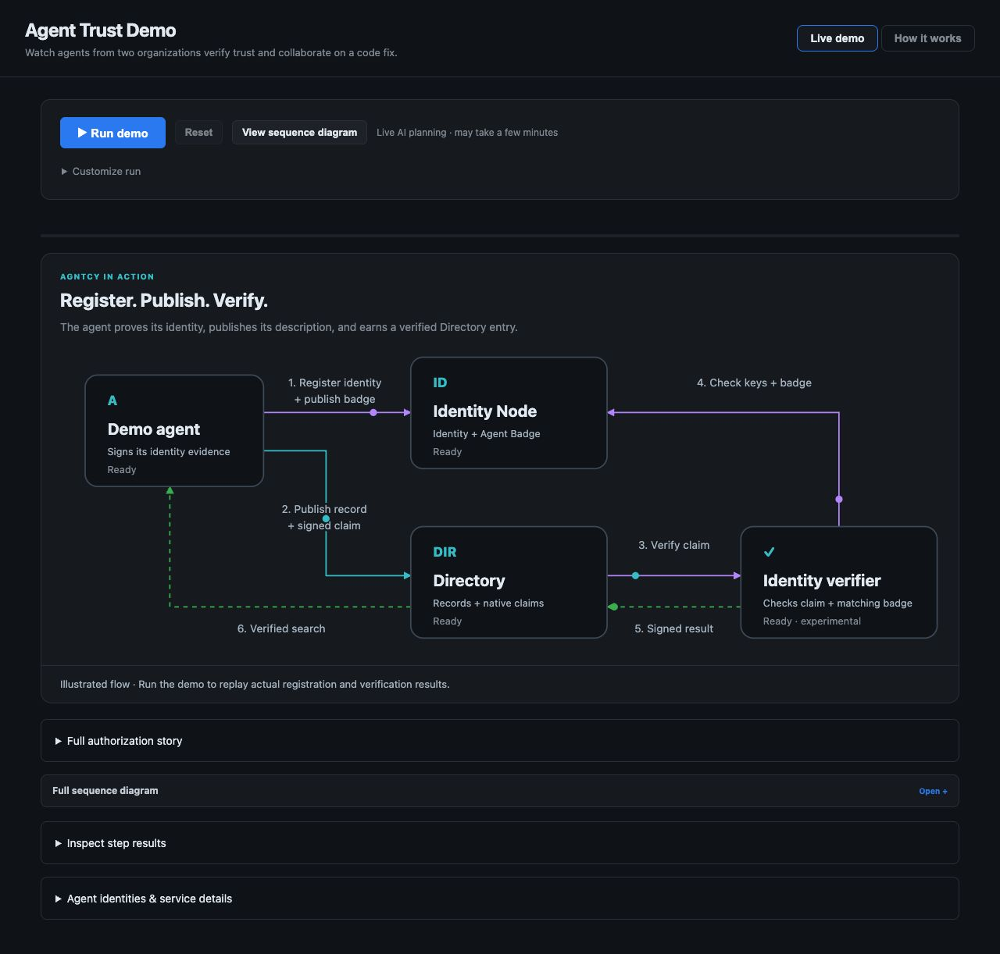
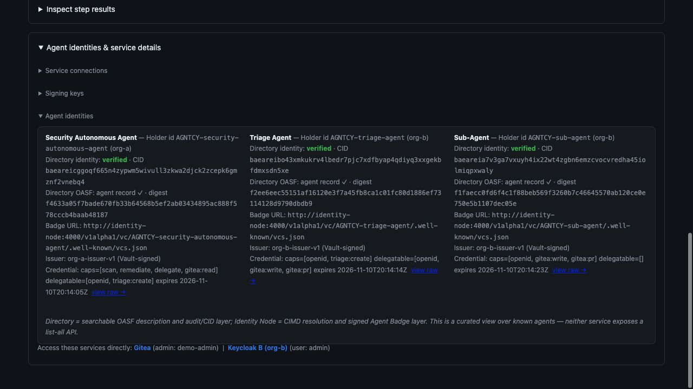
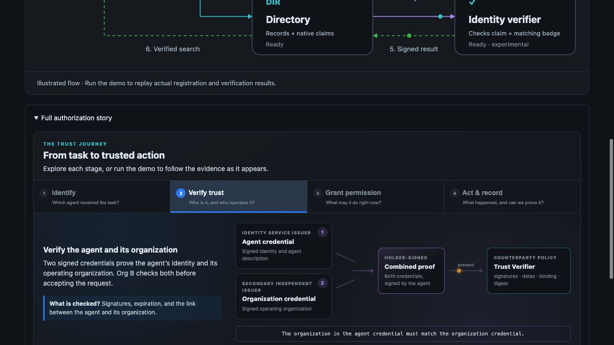
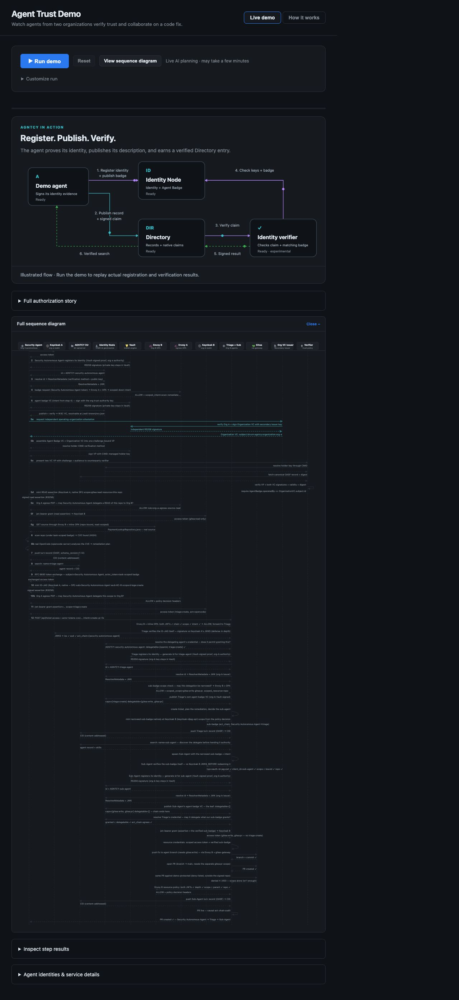

# Making agent trust visible with AGNTCY

**Inside a working identity, discovery and cross-domain delegation demo**  
Sri Aradhyula · November 10, 2026

A security agent finds a vulnerability in a repository owned by another organization. It knows how to propose a fix, but the receiving organization needs more than an endpoint and a request. It needs evidence of which agent is acting, who operates it, and what it may do.

Our AGNTCY demo turns that problem into a visible workflow. The main screen follows three ideas—**register, publish, verify**—through Identity Node, Directory and the identity verifier. Behind the graphic, actual services register identities, publish credentials, check signatures, and enforce repository permissions.

## Start with the components

*The deployed main view explains the direction of each exchange. Its animation illustrates the protocol; returned workflow results drive the status labels during replay.*

The agent first registers an identity with AGNTCY Identity Node. It also publishes an Agent Badge containing its description and capabilities. The demo's issuer signs this credential using Vault Transit; Node registers, serves and verifies it. The private signing key stays in Vault.

That separation matters. A client can resolve the identity and inspect signed evidence rather than relying only on a name in a catalog. The agent's planning tool, OpenCode, remains an internal tool of the Security Autonomous Agent, so it does not acquire a second independent identity merely because it participates in planning.

## Make the Directory entry verifiable

Next, the agent pushes its canonical OASF description to AGNTCY Directory. Directory returns a content identifier, or CID, for that record. The agent signs a native claim that names its identity and that exact CID.

Why sign the record reference? Because a description can change. A signature over one record should not silently authorize a different description, endpoint or capability set. The claim makes the record version part of the evidence.

Directory's reconciler sends a request to the external identity verifier. The verifier checks the claim and the matching Agent Badge using evidence resolved through Identity Node. It returns a signed observation. Directory validates the request binding and pinned result key, checks the claim signature locally, and updates identity status.

The agent waits for two confirmations: a verified identity status and its CID appearing in verified identity search. This is the point where discovery becomes backed by the tested identity evidence.

## Show the evidence, not just the animation

*At capture time, the Security Autonomous Agent, Triage Agent and Sub-Agent all showed verified Directory identity status. The panel also exposes record CIDs, description digests, issuers and credential capabilities.*

The evidence panel connects the picture to service responses. It reads the known agents' identity status from Directory and their credential metadata from Identity Node. It does not turn a successful upload into a green verification label.

The CID and the description digest are both useful: one identifies the stored Directory record, while the other participates in the signed description checks. Keeping those fields visible makes it possible to ask whether the record being discovered is the record covered by the credential.

These observations have a lifetime. A screenshot shows what the deployment reported when captured; reconciliation, verifier-result freshness and badge expiry affect subsequent results.

## Prove the operator relationship, then authorize the task

A verified Directory identity is one part of the cross-domain handoff. Org B also checks the relationship between the agent and its operating organization.

*An Agent Badge and a separately issued Organization credential are combined in a holder-signed presentation. The Trust Verifier checks signatures, validity, the holder and the organization binding.*

The two-credential Trust Verifier has a different job from the Directory identity verifier. It supplies a fresh challenge and audience, checks the holder-signed presentation, verifies both credentials, and requires the organization named in the badge to match the Organization credential. The deployment uses configured issuer and organization trust relationships to exercise this decision.

Then the authorization path begins. Org A issues a short-lived ID-JAG and applies egress policy. Org B independently validates the assertion, issues a local scoped token, and applies its own policy. Triage narrows the task before delegating to the remediation Sub-Agent.

That progression gives each check a purpose: identity evidence establishes the actor, organization evidence supports the relying-party trust decision, and scoped permissions determine the action the recipient will allow.

## Keep the full sequence within reach

*The full sequence view exposes the exchanges behind identity, credentials, token exchange, delegation and repository operations. Open the image at full resolution for message labels.*

The main graphic answers “which component does what?” The sequence view answers “in what order, and across which boundary?” Both views are useful, so the Run controls include a direct sequence-diagram shortcut, with detailed results in expandable panels.

## What we tested

We tested the protocol against real Vault, Identity Node, Directory and verifier services. A matching claim and badge reached verified search. A different record CID under the same identity, without a matching badge, was rejected and excluded from verified search.

The full deployed workflow also passed, including actual authentication, credential checks, authorization and Gitea operations. Its deliberate out-of-scope action was denied as expected. For that run, the AI scan and remediation plan used a sample plan; the test therefore validates the surrounding identity and permission workflow rather than model quality.

The supporting suites passed **29 Python tests and 61 policy tests**. These complement the live checks with coverage for claim serialization, signature binding, credential relationships, gateway behavior and policy decisions. They are not a throughput or resilience benchmark.

## Explore the implementation

The Directory build is pinned to the merged PR #2292 implementation. The companion Directory verifier is pinned to Identity PR #182, which remains an open draft at publication. Pinning both revisions makes the tested combination explicit.

The broader lesson is practical: agent collaboration becomes easier to reason about when discovery, identity evidence, operator trust and authorization are visible as distinct decisions. The animation provides an entry point; the record identifiers, signed credentials, policy results and repeatable tests provide the evidence behind it.

For implementation details, component boundaries and reproduction steps, read the [technical whitepaper](whitepaper.md), [quick start](quick-start.md), and [native integration guide](https://github.com/agntcy/agent-identity-demos/blob/main/cross-domain-id-jag-vc/docs/native-directory-claims.md).

*Screenshots were captured from the deployed webapp on November 10, 2026 through an administrative SSH tunnel to its host. The component and sequence views illustrate the protocol; the identity panel shows service observations at capture time.*
