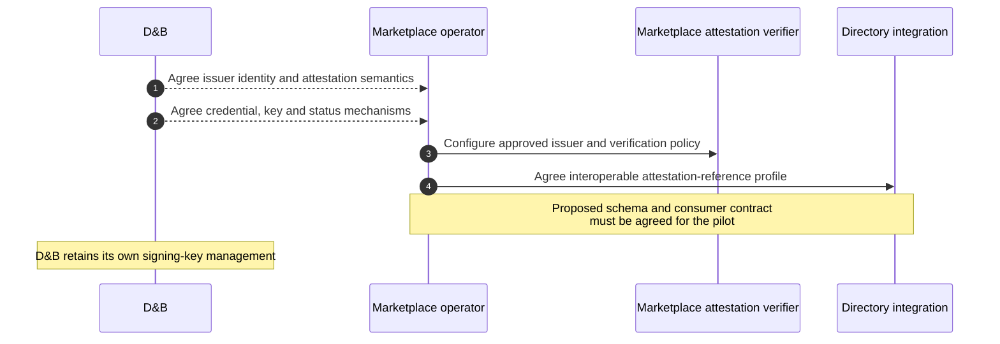
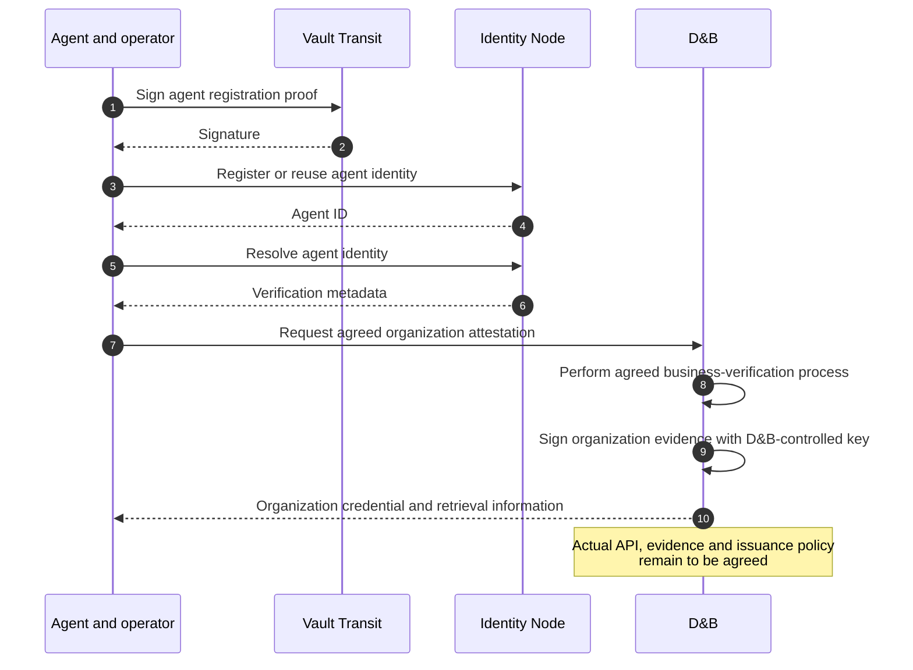
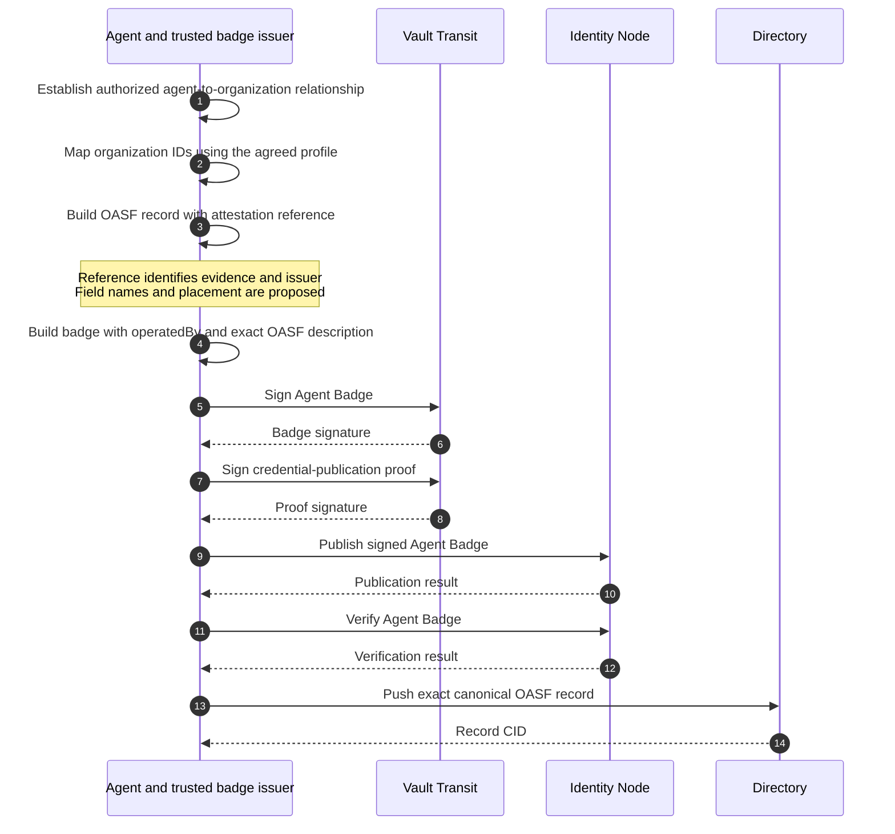
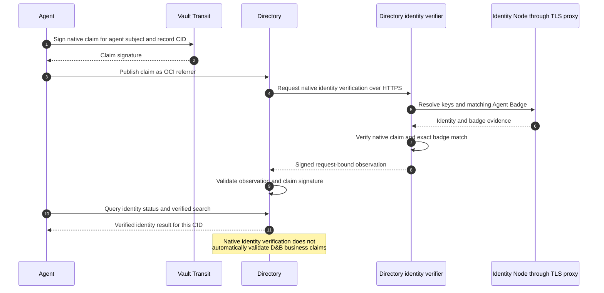
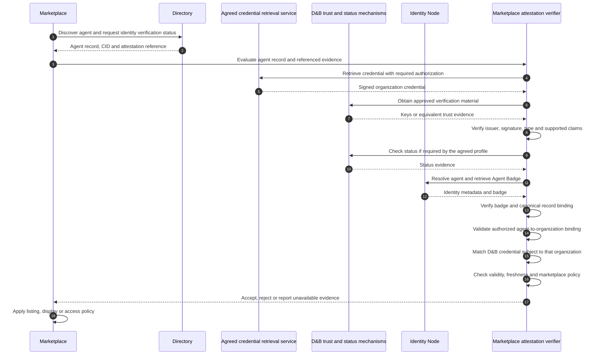
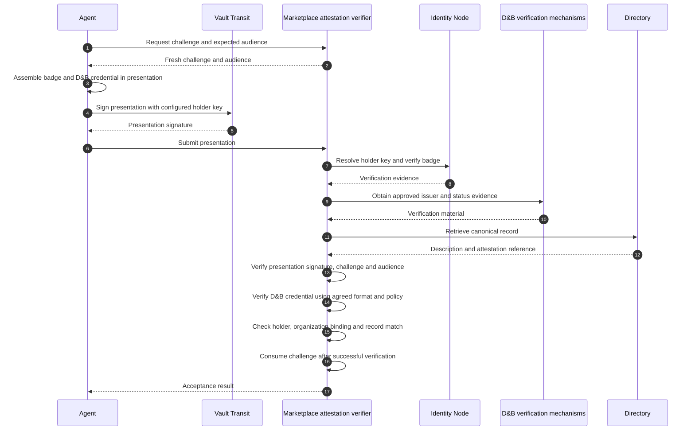
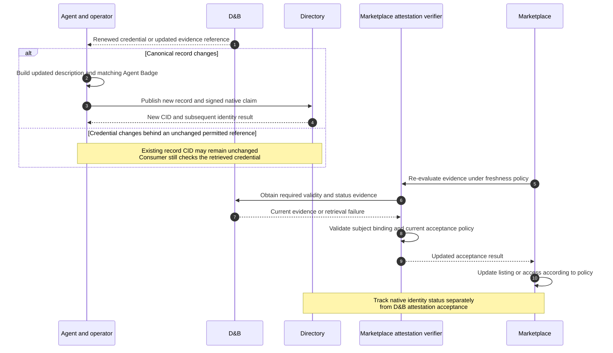

# Supporting D&B attestations with AGNTCY

**Status:** Proposed extension, not implemented  
**Date:** November 10, 2026  
**Baseline:** [Current AGNTCY demo sequences](agntcy-sequences.md)

This proposal extends the current agent-identity flow with an organization attestation issued by D&B. D&B would supply evidence about an organization. AGNTCY Identity would continue to establish agent identity and serve Agent Badges. Directory would make the agent record and its attestation reference discoverable. A marketplace, or its chosen verifier, would evaluate the evidence under its own trust policy.

All D&B interactions below are conceptual. They do not describe an existing D&B API, credential schema, signing algorithm, status protocol or integration commitment. Those contracts must be agreed with D&B and the pilot marketplace. No pilot or partner integration is asserted to be operational.

## Proposed responsibility split

| Component | Proposed responsibility |
|---|---|
| Agent operator | Obtain the organization attestation and establish the authorized relationship between organization and agent |
| D&B | Verify the agreed organization facts, issue signed evidence and supply its verification and lifecycle mechanisms |
| Vault Transit | Continue signing the demo's registration proofs, Agent Badges, native claims and presentations |
| Identity Node | Continue registering and resolving agent identities and serving signed Agent Badges |
| Directory | Store the canonical agent record and agreed attestation-reference metadata, plus existing native identity claims |
| Directory identity verifier | Continue checking native identity control and the matching Agent Badge |
| Marketplace attestation verifier | Validate D&B evidence, organization binding, freshness and marketplace acceptance policy |
| Marketplace | Decide what the accepted attestation means for listing, filtering, display or access |

The existing demo's two-credential Trust Verifier is a starting point for the marketplace verifier role. The Directory identity verifier remains a separate service with a separate result meaning.

## 1. Configure trust and an interoperable credential profile

**What would happen:** The marketplace chooses which D&B issuer identities, credential types, claims and verification mechanisms it accepts. The pilot agrees how an attestation reference is represented in an agent record.

**Why:** A discoverable link needs a shared interpretation before multiple marketplaces can consume the credential consistently.

AGNTCY's existing issuer bootstrap and internal TLS setup remain as described in the current-demo document. D&B does not automatically need to register as an Identity Node issuer: the proposed organization credential can be verified independently by the consumer. Registering it with Node would be a separate compatibility decision.

## 2. Register the agent identity and obtain organization evidence

**What would happen:** The agent follows the existing Vault-backed identity registration flow. Separately, its operator obtains D&B's signed attestation about the organization.

**Why:** These establish different facts. The agent controls its registered identity; D&B attests the specific organization facts covered by the agreed product and credential profile.

A D&B organization credential alone would not prove that a particular agent is authorized to represent that organization. The pilot must establish which issuer or enrollment process is trusted to make the agent-to-organization assertion. The current demo uses configured trust relationships; a general marketplace needs an explicit equivalent.

## 3. Bind the agent record, badge and attestation reference

**What would happen:** The canonical record includes the agreed reference to D&B evidence. The Agent Badge signs that exact description and names the operating organization. The Organization credential's subject must be mapped to the same organization identifier.

**Why:** Consumers need to connect a discovered agent to the correct organization evidence, without accepting an unrelated company's credential.

The reference must be included before finalizing the signed description if it is part of the canonical record. Adding or changing it later changes the record CID and requires a matching badge and native claim for the new record. An existing D&B credential could remain usable if its subject, validity and permitted use still satisfy policy.

The pilot should choose whether the reference identifies a particular credential version, a status-aware retrieval endpoint, or another signed evidence artifact. A schema-recognized link is useful even when verification remains entirely consumer-side. A neutral discovery format does not require every consumer to adopt the demo's presentation protocol.

## 4. Complete the existing native Directory identity verification

**What would happen:** The record's native identity claim follows the same flow as today, even when the record contains an external attestation reference.

**Why:** Directory must still establish which agent identity claims that exact record. This result is distinct from the marketplace's acceptance of D&B evidence.

The verifier observation still uses its configured private result key. Directory's pinned-key and freshness checks continue to apply. A separate D&B acceptance status must not be inferred from native `verified=true`.

## 5. Discover and verify the D&B evidence at the marketplace

**What would happen:** A marketplace discovers the agent record, reads its attestation reference, obtains the evidence through the agreed mechanism and validates it using approved D&B trust material.

**Why:** Directory can stay neutral while marketplaces consume independently issued evidence through a consistent profile.

The retrieval service could be D&B, an operator-controlled service or another location permitted by the agreed credential profile. A URL alone is not proof of issuer authenticity. The consumer must authenticate the credential and its subject using approved trust material and policy.

D&B attestations may also have access, redistribution and commercial restrictions. The pilot must agree whether Directory stores only references and permitted metadata, and how authorized marketplaces retrieve the underlying evidence.

## 6. Optionally extend the existing two-credential presentation

**What would happen:** When the marketplace needs the agent to prove possession during an interaction, the agent presents its badge and the D&B organization credential together, following an agreed presentation profile.

**Why:** This extends the current challenge-bound demonstration. It is an optional interaction pattern, not a prerequisite for attaching an external attestation reference to a record.

The current code expects a particular Organization credential type and JWT format. Supporting D&B requires implementing its agreed format, subject mapping, key resolution and lifecycle checks rather than simply replacing the issuer URL.

## 7. Handle change and preserve separate decisions

**What would happen:** The marketplace refreshes its acceptance result as credentials expire, statuses change or record content is updated. Agents continue peer discovery and audit publication using the existing AGNTCY paths.

**Why:** A valid identity binding and an accepted business attestation can change independently. A single permanent “verified” badge would hide that distinction.

Polling, notifications, cache lifetimes and the treatment of unavailable status services are design decisions, not implemented guarantees. Record updates must still follow badge publication and native claim verification from steps 3 and 4.

## What exists and what needs agreement

| Capability | Current demo | Proposed D&B work |
|---|---|---|
| Agent registration and badge publication | Implemented with Node and Vault | Reuse the existing path |
| Native Directory claim verification | Implemented | Reuse with the exact referenced record |
| Independent Organization credential | Demo issuer with configured organization data | Replace with D&B-issued evidence under an agreed profile |
| Agent-to-organization trust | Explicit demo issuer and organization configuration | Define accepted enrollment or issuer authority and identifier mapping |
| Credential reference in Directory | Agent Badge reference exists | Agree schema, placement and metadata for external organization attestations |
| Two-credential presentation | Implemented for the demo's credential format | Optional adaptation to the agreed D&B presentation profile |
| Issuer keys and credential status | Demo-specific verification | Agree D&B verification material, status, rotation and caching |
| Marketplace acceptance | Demo Trust Verifier applies configured policy | Define each marketplace's acceptance and failure behavior |

## Proposed pilot acceptance criteria

1. A consumer discovers the D&B evidence reference through the agreed record profile.
2. An authorized consumer retrieves evidence and authenticates the approved issuer.
3. The credential concerns the organization bound to the discovered agent by an accepted authority.
4. Wrong-organization, altered, unsupported, expired and unacceptable-status evidence is rejected.
5. Record changes invalidate the old record/badge association until the matching evidence is published and verified.
6. Retrieval or status failures produce the agreed unavailable or rejection outcome, without silently upgrading trust.
7. Native identity verification and organization-attestation acceptance remain separately observable.
8. A second marketplace can consume the same profile, with documented verification and acceptance behavior.

## Discussion with the Directory team

The request to the Directory team is to agree how external attestations are represented and exposed, how their subjects bind to agent records, and whether any generic verification-result mechanism is needed beyond consumer-side verification. D&B retains responsibility for its attestation semantics and issuance. Marketplaces retain responsibility for accepting that evidence and deciding its effect.

The smallest pilot can begin with discoverable references plus consumer-side verification. Directory-side reconciliation of business attestations would be a separate extension with an explicit schema, verifier interface and result meaning.
