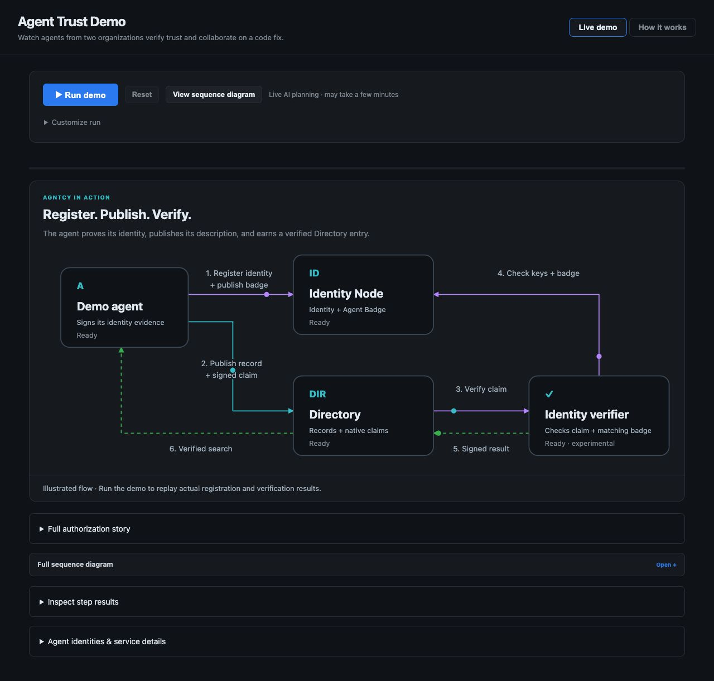
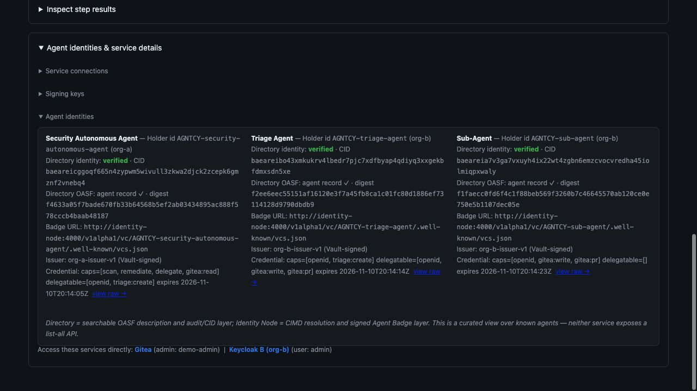
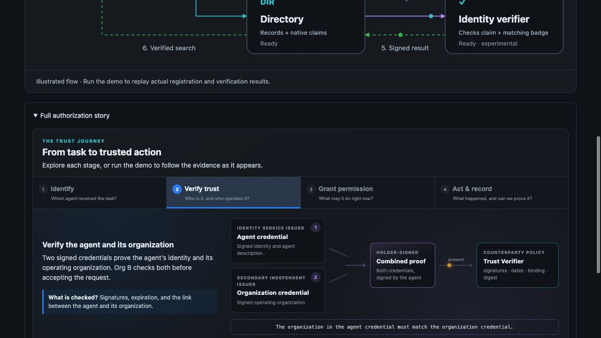
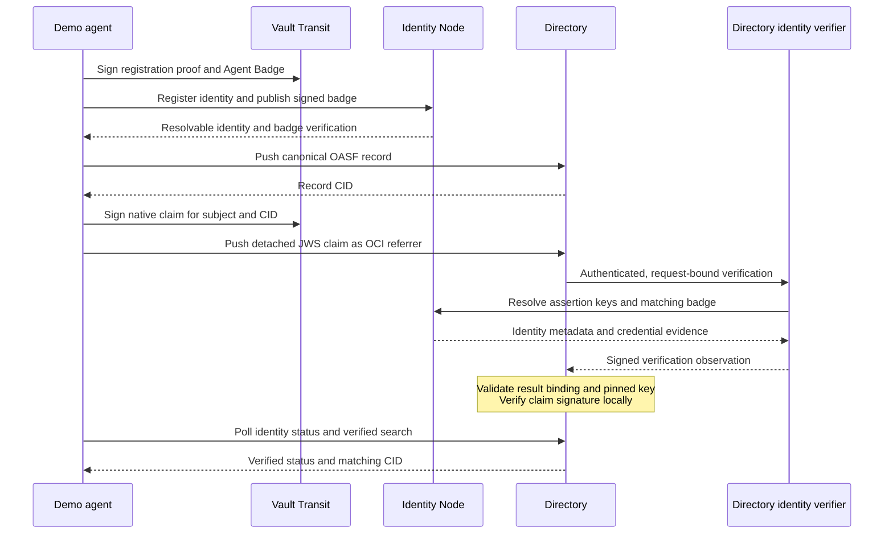
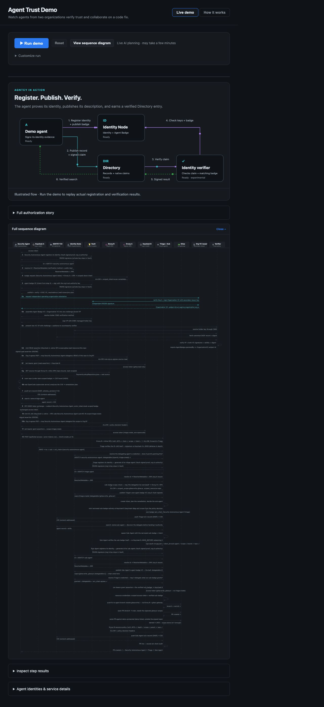

# From agent discovery to verified action

**A technical whitepaper on the AGNTCY identity and cross-domain trust demo**  
Sri Aradhyula · November 10, 2026

## Abstract

An agent directory can tell a client where to send a request. A signed credential can establish who controls an identity. A resource owner must still decide whether that identity may perform a particular action. Connecting these decisions is essential when agents collaborate across organizations.

This reference implementation connects AGNTCY Identity Node, AGNTCY Directory native identity claims, Vault-backed signing, and a cross-domain authorization workflow. A security agent in Org A delegates a repository remediation task to agents in Org B. Each participating agent has an identity and published Agent Badge. Directory associates the agent's canonical description with a signed claim, verifies evidence through an external verifier, and exposes verified identity search. Separate organization-trust and authorization checks govern access to the repository.

The deployment exercises real identity registration, credential publication, claim verification, policy evaluation, and repository operations. An animated component view makes these relationships visible; detailed sequence and evidence panels support inspection. This paper explains the implementation, the rationale for its boundaries, and the evidence collected from testing.

## 1. The engineering problem

A discovered endpoint introduces several questions: Who controls it? Does its advertised description match signed evidence? Which organization operates the agent? Who authorized this task? Can the recipient independently enforce the requested scope?

Treating a successful directory upload as an answer to all of these questions creates an avoidable trust gap. Likewise, a valid signature alone cannot establish that a repository operation falls within the resource owner's policy. The design therefore connects distinct evidence and decision layers:

| Layer | Evidence or decision | Purpose |
|---|---|---|
| Discovery | Canonical Open Agent Schema Framework (OASF) record, endpoint and content identifier (CID) | Locate an agent and identify the exact published description |
| Agent identity | Resolvable identity and signed Agent Badge | Establish identity evidence and bind the agent description |
| Native Directory verification | Signed claim, matching badge and authenticated verifier result | Associate the record CID with verified identity evidence |
| Organization trust | Agent Badge and independently issued Organization credential, presented together | Evaluate the configured relationship between the agent and its operator |
| Authorization | Short-lived ID-JAG, receiver-issued token and local policy | Limit a concrete operation at the receiving organization |
| Execution evidence | Repository result and workflow audit records | Inspect what happened across the delegation chain |

## 2. The deployed AGNTCY flow



*Figure 1. The deployed component map. Moving packets illustrate protocol direction. The initial “Ready” labels describe an idle view; they are not a completed verification trace. Run results update the component labels during replay.*

The numbered arrows explain six interactions:

1. **Register identity and publish the badge.** The agent uses Vault-backed signing and Identity Node registration. It constructs a signed Agent Badge containing its canonical agent description, publishes it to Node, and checks the credential. Node provides registration, resolution, publication and verification APIs; the demo's issuer constructs and signs the badge.
2. **Publish the record and signed claim.** The agent pushes its description to Directory, receives a CID, signs a native identity claim for that CID, and stores the claim as an OCI referrer. This binds identity evidence to a specific record version.
3. **Request verification.** Directory's identity reconciler calls the configured external identity verifier over authenticated HTTPS.
4. **Check keys and badge.** The verifier resolves the relevant assertion keys and Agent Badge through Identity Node. It checks the signature and the match between the badge and the record being claimed.
5. **Return a signed result.** The verifier returns an observation bound to the request. Directory checks that result against a pinned key and verifies the claim signature locally.
6. **Confirm verified search.** The agent waits for both verified identity status and inclusion of its CID in verified identity search. A record upload alone cannot complete this badge step.

### Why keep these components explicit?

Identity Node supplies resolvable identity and credential evidence. Directory stores and indexes descriptions and claims. The external verifier bridges the evidence checks required by native Directory reconciliation. Their separate roles make it possible to inspect a failed publication, a failed badge match, or a failed verification result without treating them as the same event.

Vault Transit remains the signing boundary. The agent requests signatures; private signing keys remain in Vault. Org A and Org B use separate issuer keys and Keycloak realms, while this deployment shares an Identity Node service. The demonstration is not a measurement of infrastructure isolation between independently operated organizations.

## 3. What binds an identity to a Directory record?

The canonical OASF record declares its subject through an annotation:

```json
{
  "annotations": {
    "agntcy.dir/identity": "agntcy://<agent-id>"
  }
}
```

The same canonical description is embedded in the Agent Badge. The client rejects a claim subject that differs from the record annotation. After Directory assigns a CID, the client constructs the claim signing payload in the field order expected by Directory:

```json
{
  "record_cid": "<record-cid>",
  "role": "CLAIM_ROLE_IDENTITY",
  "subject": "agntcy://<agent-id>",
  "signed_at": "<UTC timestamp>",
  "expires_at": ""
}
```

Vault signs the detached RS256 JWS input. The claim is published with the OCI referrer type `agntcy.dir.identity.v1.IdentityClaim`. A signature for one CID cannot be substituted for a different record without invalidating the signed payload. A correctly signed claim for another record must also satisfy the matching-badge requirement.

The verifier result adds a second binding. Directory checks the expected protocol metadata and request association, including the request digest carrying the nonce, before accepting the signed observation. Redirects are disabled on this verification path. These checks reduce the opportunity to substitute a result from a different subject, record, request, or verifier context.

The configuration reconciles identity every ten seconds and sets a five-minute maximum age. Verifier observations are valid for at most five minutes and are also bounded by badge expiry. The empty claim expiry above does not imply indefinitely valid verified search results: observation freshness and badge validity remain relevant.

## 4. Inspecting the registered-agent evidence



*Figure 2. The deployed evidence panel, captured on November 10, 2026. All three configured agents showed verified Directory identity status at capture time. CIDs, record digests, issuers and credential capabilities are visible without exposing private keys or raw tokens.*

The panel answers a concrete operational question: did the configured services produce a verified association for each known demo agent?

The Security Autonomous Agent belongs to Org A; Triage and the Sub-Agent belong to Org B. The UI reads native status from Directory and credential metadata from Identity Node. It shows the Directory record CID separately from the digest used in the credential description. These identifiers serve related but distinct purposes and should not be treated as interchangeable strings.

This panel is a curated lookup over the demo's three known agents. It is not a general inventory API. Verification status is time-sensitive; the screenshot records an observation, rather than asserting that these credentials remain valid indefinitely.

## 5. From verified identity to cross-domain permission

The full scenario begins when the webapp sends an Agent-to-Agent (A2A) task to the Security Autonomous Agent. OpenCode is that agent's internal planning tool. It has no separate A2A identity in this implementation.

The workflow then establishes organization trust and obtains permission to act in Org B. There are **two verifier roles**:

| Service | Evidence it checks | Consumer of its result |
|---|---|---|
| Directory identity verifier | Native claim signature, assertion keys and matching Agent Badge | Directory identity reconciliation |
| Two-credential Trust Verifier | Holder-signed presentation, Agent Badge, Organization credential and configured trust policy | Org B's relying-party workflow |



*Figure 3. The deployed “Verify trust” stage. Two separately issued credentials enter one holder-signed presentation; the relying-party verifier checks their relationship and configured policy.*

The Trust Verifier issues a challenge and expected audience. The agent presents an Agent Badge and an Organization credential together in a signed Verifiable Presentation (VP). The verifier resolves the holder's key, checks the presentation and both credentials, and requires the badge's `operatedBy` value to match the Organization credential's subject. It also compares the signed description and digest with the Directory record.

This deployment uses configured issuer and organization trust relationships. Its Organization credential demonstrates the binding and acceptance logic; it is not evidence of an external business-registry accreditation process.

After those checks, Keycloak A mints a short-lived identity assertion authorization grant (ID-JAG). Org A applies egress policy. Keycloak B independently validates the incoming assertion and issues a local scoped token. Org B's Envoy and inline Open Policy Agent (OPA) boundaries enforce repository and action constraints. Triage narrows authority before dispatching the remediation Sub-Agent.

The resulting workflow includes an intentional action outside the permitted scope. Its denial is expected evidence that policy enforcement is active, alongside the approved repository operation.

## 6. The sequence behind the animation



The diagram groups signing and registration interactions for readability. The UI's component states reflect returned workflow-step results; the moving packets are an explanation of the protocol, not separately timestamped network telemetry.

[](../assets/agent-trust/03-protocol-sequence.jpg)

*Figure 4. The deployed full-sequence view adds token exchange, organization trust, delegation, policy checks and repository execution. Open the image at full resolution to inspect individual messages. This screenshot shows the protocol map before replay.*

## 7. Validation and observed results

Validation was performed on November 10, 2026. Different checks establish different properties:

| Validation | Result | What it establishes |
|---|---|---|
| Client, A2A, catalog and trust-bundle unit tests | 10 passed | Claim wire compatibility, CID signature binding, subject consistency, rejected-badge handling and related client behavior |
| Two-credential proof tests | 4 passed | Successful presentation and rejection of changed identity metadata, operator binding and challenge |
| Gitea gateway tests | 15 passed | Gateway behavior, including its mocked outbound Gitea interactions |
| OPA policy suites | 61 passed | Egress, resource-access and ticket-ingress policy behavior |
| Isolated live native-claim smoke test | Passed | Real Vault, Node, Directory and verifier accepted a matching badge/claim and rejected a different CID without a matching badge |
| Full deployed workflow | Passed with expected policy denial | Real identity, authorization and Gitea paths; AI scan and remediation plan replaced with a sample plan |
| Browser inspection | Three verified agents observed | Deployed UI displays actual Directory status and record identifiers |
| Documentation build | Passed in strict mode | Whitepaper, blog, images and navigation compiled with MkDocs |

The isolated live test checks both positive verified search and exclusion of the mismatched record. Its success demonstrates the tested binding behavior; it is not a performance, race, failover or security-audit result. No throughput or latency benchmark is claimed here. The full workflow result also does not assess live model quality because its scan and plan were mocked for that run.

### Reproduce the verification checks

Use the [quick start](quick-start.md) for environment setup and the [demo README](https://github.com/agntcy/agent-identity-demos/blob/main/cross-domain-id-jag-vc/README.md) for required dependencies and service configuration. From the demo directory, the opt-in protocol smoke test runs as follows:

```sh
docker compose run --rm --no-deps -T --entrypoint python webapp - \
  < tests/live_native_claims.py
```

The test creates a dedicated identity and unique records. Prefer an isolated database and OCI repository when running it against shared infrastructure; test artifacts remain in the selected deployment. The native integration guide below documents the ordinary unit-test command and upgrade precautions.

## 8. Implementation baseline and operational considerations

| Component | Tested implementation |
|---|---|
| Directory daemon | Merged PR #2292, commit `9ad81444be3d213e2c84e2a4299021728da742ec` |
| Directory identity verifier | Identity PR #182, commit `53ec1e34049ddb34e8caed9762b4ab0ae5516838`; open draft at publication |
| Identity Node | Existing demo version `0.0.23`, with the Vault-backed identities and assertion keys exercised by the live test |
| Identity reconciliation | Ten-second interval; five-minute maximum age |
| Signing and transport | Vault Transit, internal HTTPS, bearer authentication and a pinned verifier result key |
| Persistence | PostgreSQL, Zot, Directory routing state, and separate volumes for internal trust and verifier secrets |

These pins describe a reproducible integration baseline. Compatibility with other Node enrollment modes or later verifier revisions requires its own validation. Internal TLS certificate renewal requires rerunning the trust initialization service and restarting the proxy and verifier when certificates approach expiry. Verifier result keys and tokens persist across rebuilds.

Upgrades should preserve environment overrides, backing databases, registry content and signing state. Source and database backups were taken before the deployed upgrade. Operational setup, key lifecycle management, service isolation and recovery procedures remain deployment responsibilities.

## 9. Design implications

This implementation makes the chain of evidence inspectable. A client can associate an advertised description with a specific CID, verify that an identity claims that record, and then submit additional credentials and narrowly scoped authority to the receiving organization. Each layer has an observable result and a separate failure path.

The reusable pattern is the sequence of decisions: discover a record, verify its identity binding, evaluate the operator relationship, authorize a concrete request, and inspect execution evidence. The demo gives those decisions visible components and repeatable checks rather than compressing them into a single trust indicator.

## Source and evidence references

- [Native integration configuration and test guide](https://github.com/agntcy/agent-identity-demos/blob/main/cross-domain-id-jag-vc/docs/native-directory-claims.md)
- [Claim construction and verified-search client](https://github.com/agntcy/agent-identity-demos/blob/main/cross-domain-id-jag-vc/agntcy_identity_client/native_claims.py)
- [Two-credential Trust Verifier](https://github.com/agntcy/agent-identity-demos/blob/main/cross-domain-id-jag-vc/trust-verifier/app.py)
- [Live positive and negative protocol test](https://github.com/agntcy/agent-identity-demos/blob/main/cross-domain-id-jag-vc/tests/live_native_claims.py)
- [Merged Directory implementation](https://github.com/agntcy/dir/commit/9ad81444be3d213e2c84e2a4299021728da742ec)
- [Pinned identity verifier implementation](https://github.com/agntcy/identity/tree/53ec1e34049ddb34e8caed9762b4ab0ae5516838/integrations/directory-verifier)

**Screenshot provenance.** All four figures were captured from the running webapp serving `agent-identity-demo.outshift.io` on November 10, 2026, accessed through an administrative SSH tunnel to that host. They are deployed UI captures, not locally rendered mockups. Figure 2 shows live service observations at capture time; Figures 1, 3 and 4 explain protocol structure. Raw JWTs and private key material are not included. The image manifest records filenames and hashes.
